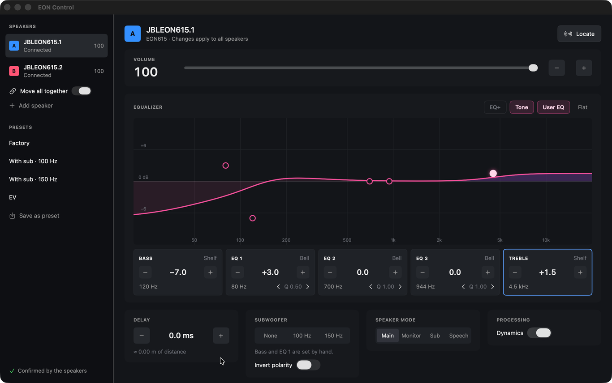

# EON Control

A native macOS app to control and EQ JBL EON615 speakers over Bluetooth, as a replacement for JBL's EON Connect.



## Features

- Connects to several speakers at once and reconnects on its own. "Move all together" applies every change to all of them.
- Volume, locate (blinks the speaker's LED), delay (0–20 ms), polarity, speaker mode (Main, Monitor, Sub, Speech) and Dynamics.
- Five-band EQ with a live response curve:
  - Bass and treble shelves, fixed by the speaker at 120 Hz and 4.5 kHz.
  - Three bells with adjustable gain, frequency and Q.
- Drag the curve's handles, use the step buttons, or scroll over any value to change it.
- Subwoofer crossover shaping at 100 or 150 Hz, independent of the speaker mode.
- Built-in and user presets.
- Every value shown is read back from the speakers, so the screen matches what they are actually doing.
- Menu bar extra for quick volume control.

## Requirements

- macOS 14 or later.
- Swift 6 toolchain (Xcode 16 or later).
- JBL EON615 speakers. Other EON600-series models will likely work, but only the EON615 has been tested.

## Build and run

```bash
./scripts/build-app.sh
```

```bash
open "build/EON Control.app"
```

The script builds a release binary and wraps it in an ad-hoc signed `.app` bundle with its icon and Bluetooth usage string. macOS asks for Bluetooth access on first launch.

Run the tests:

```bash
swift test
```

## Connecting the speakers

A speaker only advertises while it is in pairing mode and no other app holds its connection:

1. Close EON Connect on your phone.
2. Press the Bluetooth button on the back of the speaker until the blue LED blinks.
3. In the app, choose **Add speaker** and pick it from the list (it shows up as `JBLEON615.x`).

After that the app remembers the speaker and reconnects automatically whenever it is in range.

## Layout

| Path | Contents |
| --- | --- |
| `Sources/EONKit` | Protocol encoding, speaker state, presets and EQ response math, with no UI dependencies |
| `Sources/EONControl` | SwiftUI app: Bluetooth connection, model and views |
| `Tests/EONKitTests` | Protocol and EQ tests, checked against frames captured from real speakers |
| `scripts/build-app.sh` | Builds the `.app` bundle |

## Safety

The app only sends commands whose effect is known. It never sends commands that rename the speaker, change its Bluetooth address or start a firmware update. It also never writes to the speaker's firmware-update service.

## Disclaimer

Not affiliated with or endorsed by JBL or HARMAN. JBL and EON are trademarks of HARMAN International.
